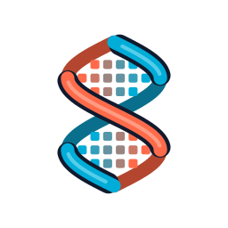

<div align="center">



<p>
  <b>An open-source Minecraft: Bedrock Edition server engine in Go</b><br>
  One-to-one with vanilla, every part replaceable, built for many cores
</p>

[-black)](https://feedback.minecraft.net/hc/en-us/sections/360001186971-Release-Changelogs)
[](https://go.dev/)
[](LICENSE)
[](#status)

</div>

## Status

Status as of 2026-10-31: **restarted from scratch with its own architecture.** Players can join,
spawn in a BDS world, see each other and use their inventory. Everything follows BDS 1.26.60.

- **Networking:** NetherNet and RakNet, and the login the way BDS 1.26.60 does it (Xbox Live
  checks, encryption, resource packs).
- **Worlds:** the world folder (`worlds/Bedrock level`, BDS's layout) opens at boot through the
  `world` library's stores. Players spawn at the level.dat spawn, or where a BDS world saved them.
  Flat and void worlds generate.
- **Chunks:** each player's simulation zone (tick-distance) stays loaded and changed chunks are
  saved at the end of each tick. The view zone (view-distance) is loaded, encoded once, sent in
  BDS's sub-chunk request mode and released. A ticket (`KeepLoaded` on a box, a radius or a list of
  chunks) keeps chunks loaded without a player, ticking or frozen, until it is released.
- **Regions:** loaded chunks belong to regions that tick in parallel at 20 TPS each and merge and
  split as players move (`TickCores` sets how many cores tick). A player who moves far away, such
  as by a teleport, goes straight to the region there instead of merging the two.
- **Block ticks:** random ticks at the level's random tick speed and the two scheduled tick queues,
  loaded from and saved to the chunk, on a world tick kept in level.dat.
- **Players and entities:** players see each other (AddPlayer within BDS's 57-chunk disc,
  `EntityViewRadius2`, changeable while running), MovePlayer for their movement, and the player
  list. Other entities stay in loaded chunks, pass to the region they move into and unload with
  their chunk; where they were is saved when they leave.
- **Abilities:** permission levels, game mode and attributes follow BDS 1.26.60 (layered abilities,
  its per-game-mode rules, its saved format) and are sent at join in BDS's order.
- **Inventory:** items are loaded from and saved in BDS's format. Every inventory change the client
  asks for is checked as BDS checks it (stack network IDs, counts, stack sizes, armour slots and
  offhand items as BDS lists them, creative-only destroy and creative items) before it happens.
- **Registry:** built at boot from BDS 1.26.60's data: 23,960 states of 1,480 blocks with their
  network hashes and BDS's runtime numbers (light, flammability, explosion resistance, friction,
  destroy time), 2,080 items, 89 biomes with BDS's numeric IDs and 138 entity types with their
  definitions, plus the creative inventory and recipes, which can change while running. Joining
  players get the registry packets; untouched, each is byte for byte BDS's.
- **Plugins:** can add, replace and delete any registry entry in `Config.Setup`. World packets go
  through a handler table plugins can replace or wrap, per packet or per system (movement so far),
  on the player's region tick.

What is left:

- **Vanilla terrain generation** is not hooked up yet, so an infinite world shows only what it has
  saved.
- **Block behaviour:** blocks tick, but no vanilla block has tick behaviour yet.
- **Dropping and crafting** items are not done yet.
- **Everything else** (mobs, combat, redstone, commands, UI) comes after core player gameplay.
  [API_DESIGN.md](https://github.com/helix-bedrock/.github/blob/main/API_DESIGN.md) lists which
  topics are designed.
- **The API is not stable yet.** Names and behaviour may still change between commits.

## How it is checked

Behaviour comes from the decompiled Bedrock Dedicated Server (BDS) 1.26.60, compared with other
servers (PocketMine-MP, PowerNukkitX, Allay) and checked against BDS itself: the packets a player is
sent, the world files BDS writes and what happens in game. The decompiled code is **not** in this
repo; it was only used to read how the game works.

## Why Helix?

Custom Bedrock servers usually behave only roughly like vanilla, and are hard to change past what
their API was built for. Helix aims to be one-to-one with BDS, so a survival server plays the same as
vanilla, while every part of the engine stays reachable and replaceable. Vanilla features are
modules built on the same public API plugins use, so a Skyblock or minigame server can turn them off,
keep the fast core and replace anything. Regions tick on many cores at once, so large servers stay
smooth.

## Quick Start

```bash
go run ./cmd/helix
```

The server opens the world in `worlds/Bedrock level` (BDS's layout).

## Features

- **Same as vanilla:** the login, the registry packets, the world format and the game rules follow
  BDS 1.26.60.
- **Everything replaceable:** registry entries and packet handlers can be added, replaced or wrapped
  by plugins, also while running.
- **Data-driven:** blocks, items, biomes, entities, creative items and recipes are loaded from
  Mojang's data in [helix-data](https://github.com/helix-bedrock/helix-data), not hard-coded.
- **Multi-core:** regions tick in parallel and merge and split as players move.
- **BDS worlds:** opens and saves worlds in BDS's own format, so they move between Helix and BDS.

## Roadmap

| Part | State |
|---|---|
| Networking and login (NetherNet, RakNet, Xbox Live, encryption, resource packs) | ✅ done |
| World storage (BDS's format, pluggable stores) | ✅ done |
| Registry (blocks, items, biomes, entities, creative items, recipes) | ✅ done |
| Chunk loading, sending and saving, tickets | ✅ done |
| Regions (parallel ticking, merge and split) | ✅ done |
| Block ticks (random and scheduled) | 🟡 ticks run; no vanilla block behaviour yet |
| Players (spawn, movement, seeing each other, abilities, attributes) | 🟡 in progress |
| Inventory | 🟡 changes checked as BDS does; dropping and crafting not done |
| Vanilla terrain generation ([worldgen](https://github.com/helix-bedrock/worldgen)) | ⬜ not hooked up |
| Mobs ([entity](https://github.com/helix-bedrock/entity)), combat, redstone, commands, UI | ⬜ not started |

**The goal is to match the latest Minecraft version exactly.** After that, every time Minecraft
updates, Helix will be updated to the new version and gain everything the update adds. The project
is maintained.

## Contributing

- **Found a bug or a difference from vanilla?** Open an [issue](https://github.com/helix-bedrock/helix/issues)
- **Want to contribute code?** Read the [contributing guide](https://github.com/helix-bedrock/.github/blob/main/CONTRIBUTING.md)
  and the [AI policy](https://github.com/helix-bedrock/.github/blob/main/AI_POLICY.md)

## License

Helix is licensed under [GPL-3.0](LICENSE). Ported code and its sources are listed in
[CREDITS.md](CREDITS.md).
