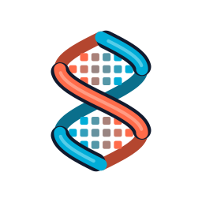

<div align="center">



<p>
  <b>An open-source Minecraft: Bedrock Edition server engine in Go</b><br>
  BDS, but better: the same mechanics, with access to everything from the lowest level to the highest
</p>

[-black)](https://feedback.minecraft.net/hc/en-us/sections/360001186971-Release-Changelogs)
[](https://go.dev/)
[](LICENSE)
[](https://helixbedrock.com/progress/)
[](https://helixbedrock.com)

</div>

## How it is checked

Behaviour comes from the decompiled Bedrock Dedicated Server (BDS) 1.26.60, compared with other
servers (PocketMine-MP, PowerNukkitX, Allay) and checked against BDS itself: the packets a player is
sent, the world files BDS writes and what happens in game. The decompiled code is **not** in this
repo; it was only used to read how the game works.

## Why Helix?

No Bedrock server software matches the official Bedrock Dedicated Server (BDS) one-to-one yet.
Helix aims to be the first: every mechanic works exactly as it does in BDS, so a survival server
plays the same as vanilla.

Helix is BDS, but better. It is built to run any kind of server and gives you access to everything,
from the lowest level (packets, chunks, ticks) to the highest (gameplay, mobs, worlds). Every
mechanic is the BDS one by default but can be replaced, and the API aims to be as rich as possible: richer than PocketMine-MP,
PowerNukkitX and Allay on Bedrock, and on par with what Paper gives Java Edition servers. Vanilla
features are modules built on the same public API plugins use, so a Skyblock or minigame server can
turn them off, keep the fast core and replace anything, down to the engine's fundamentals. Regions
tick on many cores at once, so large servers stay smooth.

## Quick Start

```bash
go run ./cmd/helix
```

The server opens the world in `worlds/Bedrock level` (BDS's layout). Add `-testcmds` for stand-in
commands while real ones are built: `/gamemode`, `/damageitem` (wear the held item, to try repairs),
`/enchanttest`, `/tune` and more.

## Features

- **Same as vanilla:** the login, the registry packets, the world format and the game rules follow
  BDS 1.26.60.
- **Everything replaceable:** registry entries and packet handlers can be added, replaced or wrapped
  by plugins, also while running.
- **Data-driven:** blocks, items, biomes, entities, creative items and recipes are loaded from
  Mojang's data in [helix-data](https://github.com/helix-bedrock/helix-data), not hard-coded.
- **The server decides:** items, inventories and craft results are held and worked out by the server.
  What a client sends is checked against that and never kept.
- **Multi-core:** regions tick in parallel and merge and split as players move.
- **BDS worlds:** opens and saves worlds in BDS's own format, so they move between Helix and BDS.

## Roadmap

Helix is **in early development and not ready for real servers yet**. The road to a stable release:

1. ✅ Engine core: networking, world storage, regions, terrain (done, Oct to Nov 2026).
2. 🟡 Every vanilla mechanic, one-to-one with BDS (in progress, aiming for summer 2027).
3. ⬜ Plugin API and custom content (2027 to 2028).
4. ⬜ Testing on real servers, then a stable release (around 2028).

These lists only cover what we know about: there are surely mechanics we have not found yet that still need to be added.

We are **actively looking for contributors**. If you know Go or Minecraft's mechanics, there is plenty to add: see
[Contributing](#contributing).

Live progress, by feature: [helixbedrock.com/progress](https://helixbedrock.com/progress/). Engine
notes with API names: [STATUS.md](STATUS.md). Updated 2026-11-12.

| Part | State |
|---|---|
| Networking and login (NetherNet, RakNet, Xbox Live, encryption, resource packs) | ✅ done |
| World storage (BDS's format, pluggable stores) | ✅ done |
| Registry (blocks, items, biomes, entities, creative items, recipes) | ✅ done |
| Chunks, regions (parallel ticking, merge and split), light, weather, day cycle | ✅ done |
| Vanilla terrain ([worldgen](https://github.com/helix-bedrock/worldgen)), the Nether and the End, portals | ✅ works in game |
| Players: movement, health, hunger, combat, shields, totems, elytra, beds | ✅ works in game |
| Inventory, containers, crafting, smithing, enchanting, anvils | ✅ works in game |
| Redstone ([redstone](https://github.com/helix-bedrock/redstone)), pistons, observers, TNT, rails and minecarts | ✅ works in game |
| Farming, plants, falling blocks, fire, fishing, bundles, fireworks | ✅ works in game |
| Mobs ([entity](https://github.com/helix-bedrock/entity)): spawning, fighting, equipment, drops | 🟡 works in game; behaviour still being checked against BDS |
| Potions, effects, brewing, crossbows, tridents, mace, breeding, leads, spawners, armour stands | 🧪 built, being tested in game |
| Command system, selectors, `/give`, `/summon`, `/teleport`, `/effect` | 🟡 works; most vanilla commands still to add |
| Villages and trading, raids, Ender Dragon, Wither, structure loot, maps, beacons | ⬜ not started |
| Load testing (400 players in one region, heavy redstone, mass entities) | ⬜ not started |
| Plugin API (WASM plugins, sandbox, custom content) | ⬜ not started |

**The goal is to match the latest Minecraft version exactly.** After that, every time Minecraft
updates, Helix will be updated to the new version and gain everything the update adds. The project
is maintained.

## Contributing

- **Found a bug or a difference from vanilla?** Open an [issue](https://github.com/helix-bedrock/helix/issues)
- **Want to contribute code?** Read the [contributing guide](https://github.com/helix-bedrock/.github/blob/main/CONTRIBUTING.md)
  and the [AI policy](https://github.com/helix-bedrock/.github/blob/main/AI_POLICY.md)

## License

Helix is licensed under [GPL-3.0](LICENSE). Ported code and its sources are listed in
[CREDITS.md](CREDITS.md).
